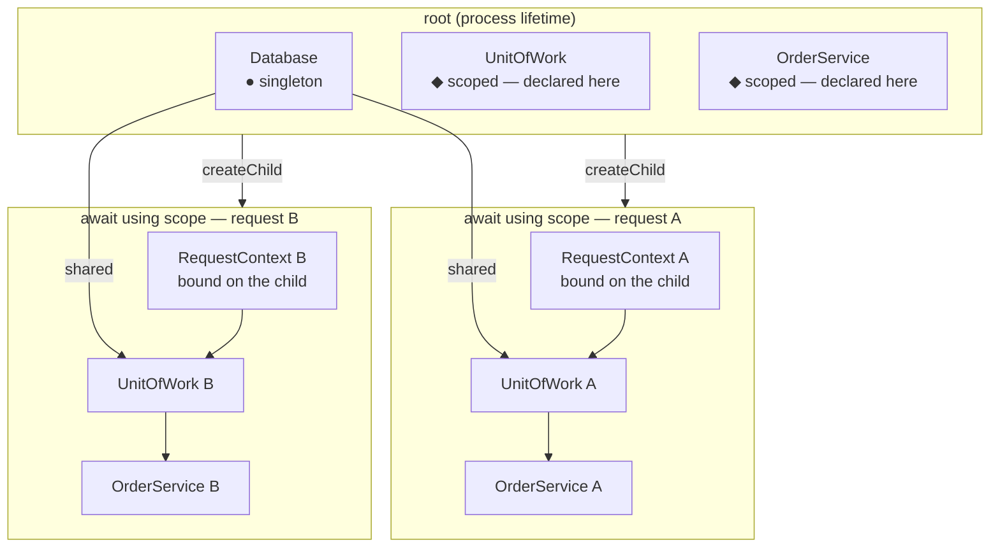

# Example 22 — Per-Request Scope

**Concepts:** `createChild()`, `await using`, `scoped`, `toConstantValue`, `validate()`

---

## What this example shows

`@codefast/di` ships no framework adapters. A per-request scope is a child container opened when a request arrives and
disposed when it ends, and TC39's `await using` already says "dispose this when the block exits" — on the success path,
the error path, and an early `return` alike. What an adapter package would add is only the framework hook to hang those
three calls on, and every framework already has one. This guide is the pattern, the rules that keep it correct, and how
it lands in [TanStack Start](#tanstack-start).

```sh
npx tsx examples/22-per-request-scope/main.ts
```

---

## The pattern

```ts
async function handle(request: Request): Promise<Response> {
  await using scope = root.createChild();
  scope.bind(RequestContext).toConstantValue({ requestId: crypto.randomUUID(), request });

  return Response.json(await scope.resolve(OrderService).place(await request.json()));
} // scope[Symbol.asyncDispose]() runs here, whether the body returned or threw
```

Three calls, each with one job:

| Call                               | What it does                                                                                    |
| ---------------------------------- | ----------------------------------------------------------------------------------------------- |
| `root.createChild()`               | One container object holding a parent reference — no binding copies, O(1) per request           |
| `scope.bind(…).toConstantValue(…)` | Makes the request itself a dependency, visible to this request's services and to no other       |
| `await using`                      | Calls `dispose()` at block exit: every `scoped` instance the request cached is deactivated here |

The container implements `Symbol.asyncDispose` and not `Symbol.dispose`, because a teardown hook may be async — a
synchronous `using` is a compile error, not a silent skip.

---

## Diagram



---

## Where each binding lives

| Lives on the root                                                      | Lives on the child                                                |
| ---------------------------------------------------------------------- | ----------------------------------------------------------------- |
| Singletons: pools, clients, configuration                              | The request itself: headers, user, tenant, a request id           |
| Request services, declared **once** with `.scoped()`                   | The `scoped` instances, cached on first resolve and disposed here |
| `validate()` and `initializeAsync()`, run once at boot, before serving | Nothing that outlives the block                                   |

Declare request services `scoped` on the root rather than binding them on every child: the declaration happens once,
`validate()` sees it at boot, and the child stays an empty container plus the request's own constants. A `scoped`
binding resolved from the root itself throws `MissingScopeContextError`, so a request service that leaks onto a code
path with no request is a loud failure rather than a shared instance.

---

## Rules

### Keep every resolve inside the block

When the block exits the child is disposed, and every later `resolve` on it throws `DisposedContainerError`. Anything
lazy that captured the scope — a `ReadableStream` whose `pull` resolves a service, an un-awaited promise, a callback
handed to a queue — runs after the exit and fails. Finish the work, or resolve what the lazy part needs, before the
block ends.

The same rule decides a one-word difference in a wrapper. In an `async` function, `return next()` exits the `using`
block **before** the returned promise settles, so the scope is torn down while the handler is still running;
`return await next()` keeps the block open until it settles:

```ts
await using scope = root.createChild();

return await next({ context: { scope } }); // not `return next(…)`
```

### A singleton must not depend on request state

A singleton built during request A keeps request A's `scoped` instance forever — a _captive dependency_. Call
`root.validate()` once at boot, after every module is loaded: it walks the graph and throws `ScopeViolationError` for a
singleton that reaches a `scoped` or `transient` binding. It does not report a `scoped` service whose `RequestContext`
is unbound on the root — that binding arrives with each child, which is the point.

### Teardown failures surface from the block

`dispose()` keeps tearing down the remaining instances when one hook throws, then throws the one error as itself or
several as an `AggregateError`. Under `await using` that error leaves the block like any other; if the body had already
thrown, the runtime wraps both in a `SuppressedError`. When a failed teardown must not turn a finished response into an
error, dispose in a `finally` you own and log it instead:

```ts
const scope = root.createChild();

try {
  return await handleWith(scope);
} finally {
  await scope.dispose().catch(reportTeardownFailure);
}
```

### Build the root once

The root is process state: build it once, behind a memoised promise when it has async bindings, and warm it with
`initializeAsync()` so a request never pays for — or races — the first async singleton. Disposing the root refuses every
operation on the children still open on it; tear it down only at shutdown.

---

## TanStack Start

Server functions and server routes run per request on the server, so they are where the scope opens. A route `loader` or
`beforeLoad` is the wrong hook: on a prerendered or ISR deployment the loader runs at build time, not per visitor, and
`beforeLoad` re-runs on the client.

### Server functions — function middleware

A function middleware wraps the handler: `next()` runs it, so a `scope` opened before `next()` and disposed after it
brackets exactly one call. The middleware hands the scope down through `context`, which stays on the server.

```ts
import { createMiddleware, createServerFn } from "@tanstack/react-start";

const requestScope = createMiddleware({ type: "function" }).server(async ({ next }) => {
  const root = await getRoot();
  await using scope = root.createChild();

  scope.bind(RequestId).toConstantValue(crypto.randomUUID());

  return await next({ context: { scope } });
});

export const placeOrder = createServerFn({ method: "POST" })
  .middleware([requestScope])
  .validator(parseOrder)
  .handler(async ({ context, data }) => context.scope.resolve(OrderService).place(data));
```

`examples/tanstack-start` runs this in production: its `/inspector` route resolves every request through
[`requestScopeMiddleware`](../../../../examples/tanstack-start/src/features/inspector/server/run-request.ts), built with
`vite build` against the published `dist/`.

### Server routes — the handler is the block

A server route handler receives the `Request` and returns a `Response`, so the scope is simply its first line. Build the
body before returning: a `Response` whose stream reads from a scoped service is consumed after the handler has returned
and the scope is gone.

```ts
import { createFileRoute } from "@tanstack/react-router";

export const Route = createFileRoute("/api/orders/$id")({
  server: {
    handlers: {
      GET: async ({ request, params }) => {
        const root = await getRoot();
        await using scope = root.createChild();
        scope.bind(RequestContext).toConstantValue({ request, requestId: crypto.randomUUID() });

        const order = await scope.resolve(OrderService).find(params.id);

        return Response.json(order); // the body is serialised now, while the scope is open
      },
    },
  },
});
```

---

## What to read next

- **Example 03** — the three lifetimes, and why `scoped` needs a child container.
- **Example 05** — async lifecycle hooks and `await using` on the root.
- **Example 09** — `ScopeViolationError`, `DisposedContainerError` and the rest of the error taxonomy.
- [Child containers](../../spec/container.md#child-containers) — the normative contract behind every rule above.

## License

Released under the [MIT License](../../LICENSE).
